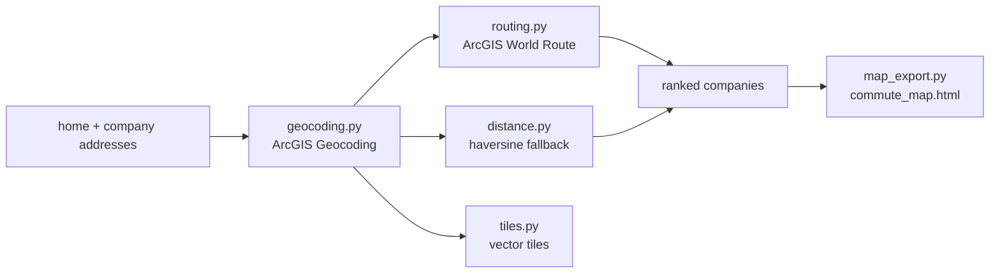

# ArcGIS Commute Insights

[](https://github.com/Deshraj-Jogiya/arcgis-commute-insights/actions/workflows/ci.yml) 

Ranks companies by commute from home: it geocodes addresses with the ArcGIS World Geocoding Service, gets drive times from the ArcGIS
routing service, decodes basemap vector tiles, and writes an interactive Leaflet map.

## Highlights

- **Geocoding** through the live ArcGIS `findAddressCandidates` endpoint.
- **Drive-time ranking** via ArcGIS World Route; if a route can't be found, it falls back to great-circle (haversine) distance instead of
  failing.
- **Basemap vector tiles:** Mapbox Vector Tile (`.pbf`) data from Esri's World Basemap v2. The tile URL template came from the basemap
  style JSON after a guessed URL returned 404.
- **Interactive map:** a self-contained `commute_map.html` (Leaflet) with home and company markers and routed paths, uploaded by CI as an
  artifact.
- **Tests call the live APIs** (no mocks), including a hand-checked slippy-map tile coordinate and assertions on observed layer names.

## Architecture



## Stack

Python, ArcGIS Location Platform (geocoding, routing, basemaps), Leaflet, pytest, GitHub Actions.

## Run it

```bash
pip install -r requirements.txt
export ARCGIS_API_KEY=<key with Geocoding, Basemaps and Routing privileges>
python -m app.main "home address" "company address 1" "company address 2"
python -m pytest tests/ -v
```

The key comes from a free [ArcGIS Location Platform](https://developers.arcgis.com) account. Without the Routing privilege, ranking falls
back to straight-line distance and the two routing tests skip with the API's error message.
